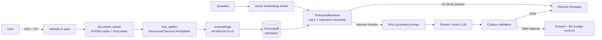
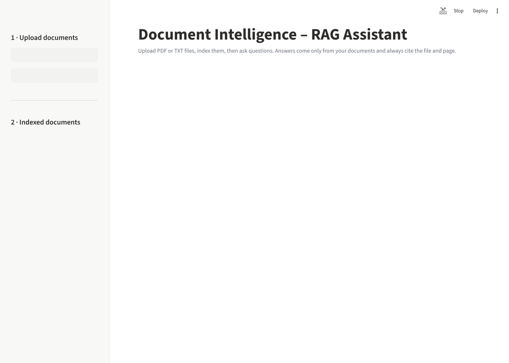
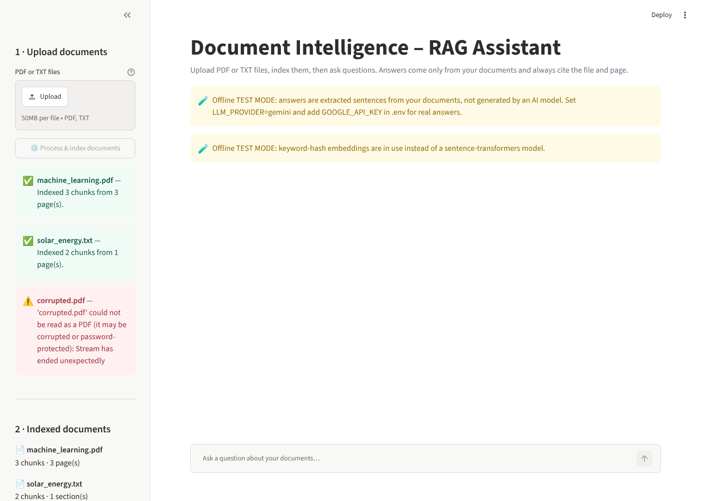
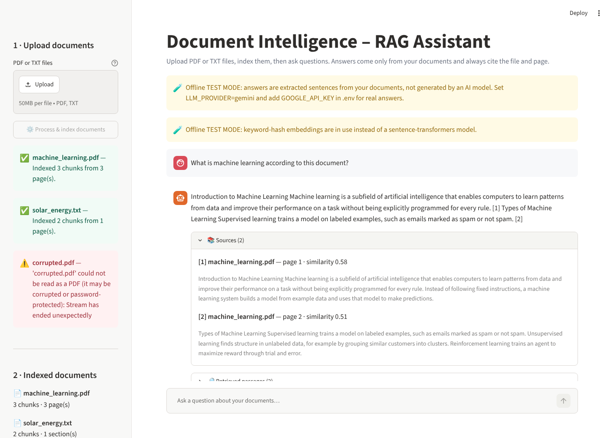
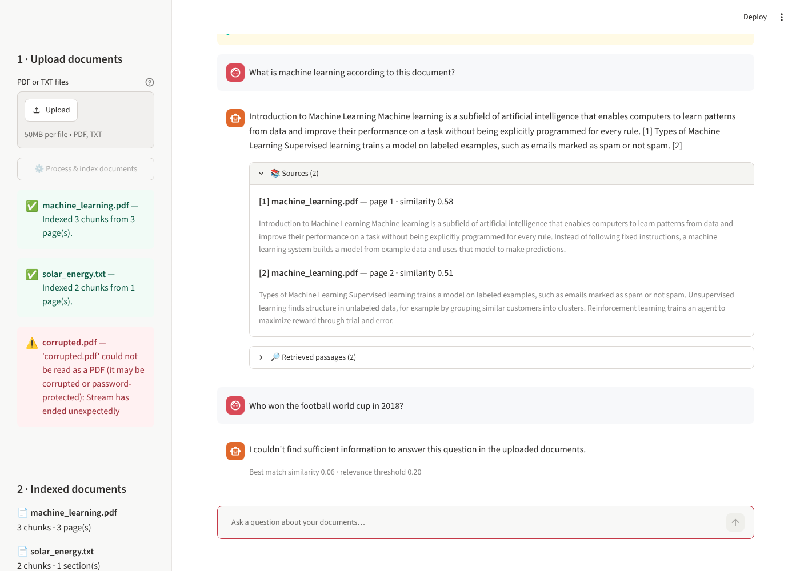
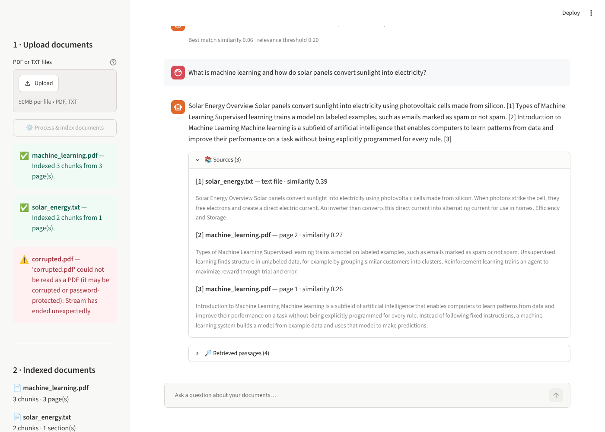
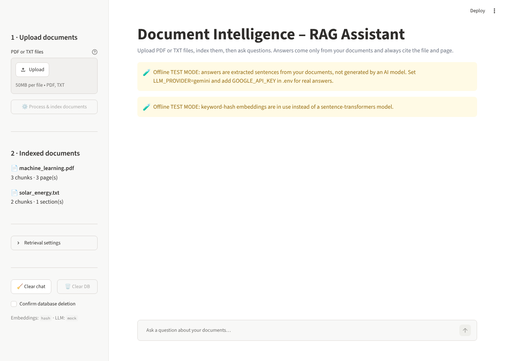

# Document Intelligence – RAG Assistant

A Streamlit app that answers questions **strictly from your own PDF and TXT files**, with a source filename and page number on every answer. If the documents don't contain the answer, it says so instead of guessing.

## Problem statement

General-purpose chatbots answer from memory and can invent facts or citations. For contracts, reports, papers and manuals you need answers that are (a) limited to the documents you supplied and (b) verifiable. This project uses Retrieval-Augmented Generation (RAG) with several independent hallucination guards so every answer can be traced back to a file and page.

## Features

- Upload multiple **PDF and TXT** files; extension, size, empty, corrupted, encrypted and image-only files are detected and reported per file (one bad file never blocks the rest).
- Page-level metadata preserved: `source`, `page_number`, `chunk_id`.
- Configurable chunk size / overlap (`RecursiveCharacterTextSplitter`).
- **Persistent ChromaDB** index – survives restarts; add more documents later without losing old ones.
- **Duplicate protection** – by file content hash and deterministic chunk IDs.
- Embedding-model guard – the index remembers which model built it and refuses to mix vectors from different models.
- **Hallucination prevention** (see below).
- Chat UI with expandable **Sources** and **Retrieved passages**, clear-chat and clear-database (with confirmation).
- Offline **test mode** (mock LLM + hashing embeddings) so everything runs without an API key or internet.

## Architecture and workflow



### Hallucination defences

1. **Relevance threshold** – chunks below a configurable cosine similarity never reach the LLM. If none pass, the LLM is *not called* and the refusal sentence is returned. Scores are model-specific, so the threshold is a setting you re-tune when you change the embedding model.
2. **Strict system prompt** – context only, no outside knowledge, no invented facts/figures/names/citations, exact refusal sentence, partial answers flagged, explicit facts separated from "Interpretation:", and retrieved text treated as untrusted data.
3. **Output validation** – an answer is shown only if it cites at least one passage that was really retrieved; invented citation numbers are stripped, and an answer with no valid citation becomes the refusal message.

## Technologies

Python 3 · LangChain (`langchain-core`, `-community`, `-text-splitters`, `-chroma`, `-huggingface`, `-google-genai`) · ChromaDB · sentence-transformers (`all-MiniLM-L6-v2`) · Gemini API (configurable) · Streamlit · python-dotenv · pypdf · pytest

## Project structure

```
rag-document-assistant/
├── app.py                 # Streamlit UI
├── config.py              # Settings from environment / .env
├── requirements.txt       # Runtime dependencies
├── requirements-dev.txt   # + pytest, reportlab
├── .env.example           # Copy to .env and add your key
├── .gitignore
├── pytest.ini
├── .streamlit/config.toml
├── src/
│   ├── document_loader.py # PDF/TXT loading + metadata
│   ├── text_splitter.py   # Chunking + chunk IDs
│   ├── embeddings.py      # HuggingFace embeddings (+ offline test backend)
│   ├── vector_store.py    # Persistent Chroma: add/search/list/clear
│   ├── retriever.py       # LangChain retriever with relevance threshold
│   ├── qa_chain.py        # Prompt, LLM factory, grounded chain, validation
│   ├── indexer.py         # Upload → validate → load → split → embed → store
│   └── utils.py           # Validation, cleaning, citation formatting
├── data/
│   ├── uploads/           # Stored copies of uploaded files
│   └── chroma_db/         # Persistent vector database
├── tests/                 # pytest suite + generated sample documents
├── scripts/browser_check.py  # Headless-browser end-to-end check
└── docs/screenshots/
```

## Installation

Requires Python 3.10+ (developed on 3.13).

**Windows PowerShell (VS Code terminal):**

```powershell
cd rag-document-assistant
python -m venv .venv
.\.venv\Scripts\Activate.ps1
pip install -r requirements.txt
```

If PowerShell blocks activation, run once: `Set-ExecutionPolicy -Scope CurrentUser RemoteSigned`.

**macOS / Linux:**

```bash
python3 -m venv .venv && source .venv/bin/activate
pip install -r requirements.txt
```

## Environment setup

```powershell
Copy-Item .env.example .env      # macOS/Linux: cp .env.example .env
```

Open `.env` and put **your own** key on this line:

```
GOOGLE_API_KEY=your-key-here
```

Get a key at <https://aistudio.google.com/apikey>. `.env` is git-ignored; the key is read only on the server and never sent to the browser. `LLM_MODEL` is configurable – if the default model name is not available to your account, set it to a Gemini model you have access to.

The first run downloads `all-MiniLM-L6-v2` (~90 MB) from Hugging Face, so internet access is needed once.

**No API key?** Set `LLM_PROVIDER=mock` (and optionally `EMBEDDING_BACKEND=hash`) for the offline test mode. The mock LLM only copies matching sentences out of your documents and is *not* a real language model.

Other settings (all in `.env.example`): `CHUNK_SIZE`, `CHUNK_OVERLAP`, `TOP_K`, `RELEVANCE_THRESHOLD`, `EMBEDDING_MODEL`, `MAX_UPLOAD_MB`.

## Run

```powershell
streamlit run app.py
```

Open <http://localhost:8501>.

## How to upload documents

1. In the sidebar, drag in or browse for one or more `.pdf` / `.txt` files.
2. Click **Process & index documents**. Per-file results appear (indexed, duplicate, or the reason it failed).
3. Indexed documents are listed under **Indexed documents** and remain after restarts. Upload more any time.

## How to ask questions

Type in the chat box. Each answer has **Sources** (file + page of cited passages) and **Retrieved passages** (everything given to the model). Tune *top-k* and the *relevance threshold* under **Retrieval settings**. Use **Clear chat** to reset the conversation, or tick *Confirm database deletion* and press **Clear DB** to wipe the index.

## Example questions and outputs

Run in offline test mode with the bundled samples (`tests/fixtures/`):

| Question | Result |
|---|---|
| *What is machine learning according to this document?* | "…Machine learning is a subfield of artificial intelligence that enables computers to learn patterns from data… [1]" — **machine_learning.pdf, page 1** |
| *What is overfitting?* | Answer from **machine_learning.pdf, page 3** |
| *What is machine learning and how do solar panels convert sunlight into electricity?* | Cites **both** machine_learning.pdf and solar_energy.txt |
| *Who won the football world cup in 2018?* | "I couldn't find sufficient information to answer this question in the uploaded documents." (no sources) |

## Source citation explanation

The model is given numbered passages and must cite them as `[1]`, `[2]`. The app maps each number back to the original metadata and shows `filename, page N` (TXT files show "text file"). Only passages the answer actually cites are listed under **Sources**; citation numbers that don't match a retrieved passage are removed.

## Testing

```powershell
pip install -r requirements-dev.txt
pytest
```

The suite covers PDF/TXT loading, empty/corrupted/blank/encrypted files, chunking, metadata, embeddings, Chroma persistence and de-duplication, retrieval, page citations, answerable vs. unanswerable questions, unsupported-answer prevention (including a deliberately misbehaving LLM), and the Streamlit UI via `AppTest` (all four required scenarios). A test that needs the real `all-MiniLM-L6-v2` model is skipped automatically when it can't be downloaded. Optional browser check: start the app, then `python scripts/browser_check.py` (needs `pip install playwright`).

## Screenshots

| | |
|---|---|
|  |  |
|  |  |
|  |  |

*Screenshots were captured in offline test mode.*

## Limitations

- Scanned (image-only) PDFs are rejected – there is no OCR.
- The default relevance threshold (0.25) is a starting point for `all-MiniLM-L6-v2`; re-tune on your documents and for any other embedding model.
- Answer quality with Gemini depends on the model and on retrieval quality.

## Future improvements

OCR for scanned PDFs · hybrid (BM25 + vector) search and re-ranking · streaming answers · conversation-aware follow-up questions · per-document delete · more file types (DOCX, HTML) · more LLM providers.
