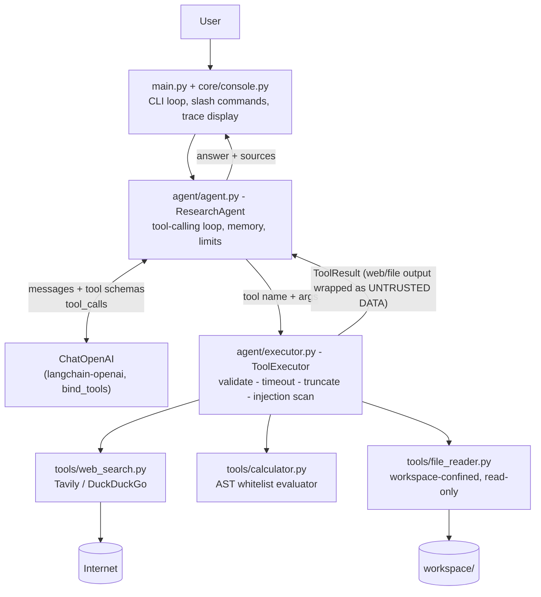

# ResearchMate AI - Autonomous Multi-Tool Research Agent

A console-based AI agent that decides **for itself** whether to search the web, do math, or read a local file - and chains those tools together to answer compound research questions.

```
User Query -> LLM decision -> Tool call -> Observation -> (more tool calls?) -> Final Answer + Sources
```

> **Verification status (please read):** all 204 offline tests pass, and the real `langchain-openai` client was exercised end-to-end against a *local OpenAI-compatible stub server*. It has **not** been run against the live OpenAI API or the live DuckDuckGo/Tavily services, because the development environment had no API key and blocked outbound search traffic. See [Limitations](#14-limitations) and [TEST_REPORT.md](TEST_REPORT.md).

## 1. Project overview

ResearchMate AI is a tool-calling agent built on `langchain-core` and `langchain-openai`. The language model receives the user's question plus three tool schemas and uses native function calling to choose tools and arguments. There is **no keyword routing** anywhere in the code: "Explain what an AI agent is" produces no tool calls, while "Read expenses.csv, total it, and find the highest" produces `read_file` followed by `calculator` calls.

## 2. Problem statement

Implement an LLM agent with (1) real-time web search, (2) a secure Python math calculator and (3) a local file reader, which autonomously decides which tools are needed, calls them, observes the results and writes a final answer - including compound queries that need several tools in one task.

## 3. Features

- **LLM-driven tool selection** via function calling; multiple sequential and parallel tool calls per query
- **Web search** with Tavily (if a key is set) and DuckDuckGo (no key) as fallback; titles, URLs, result limit, empty/timeout/network handling, "unverified snippets" labelling
- **Secure calculator**: AST whitelist, no `eval`/`exec`; `+ - * / // % **`, parentheses, `sqrt sin cos tan log factorial` and more, plus `sum/mean/min/max` over lists
- **Sandboxed file reader**: `.txt .md .csv .json .py`, confined to a workspace folder, read-only, size-limited
- **Guard rails**: max iterations, max tool calls, per-tool timeout, argument validation, duplicate-call blocking, output size limits, graceful LLM failure handling
- **Transparent trace**: shows actions, inputs and observation summaries (never the model's private reasoning)
- **Interactive CLI** with `/help /tools /clear /exit`, bounded conversation memory, source listing, `--check` offline self-test
- **Prompt-injection mitigations** for web and file content (see Security)

## 4. Architecture



**Key design decisions**

| Decision | Reason |
|---|---|
| Custom loop on `langchain-core` (`bind_tools`) instead of `AgentExecutor` | `AgentExecutor`/`create_tool_calling_agent` were removed from LangChain 1.x (they live on only in the legacy `langchain-classic` package). A small explicit loop gives exact control over iteration limits, timeouts and the trace, and is easy to test. |
| `ddgs` and `tavily-python` used directly, not `langchain-community` | `langchain-community` now emits a sunset deprecation warning. The requirement "do not rely on deprecated APIs" took priority over listing it. |
| Tools return a structured `ToolResult` (pydantic) | One typed shape for success/failure, summaries, sources and trust flags. |
| Tool output from the web/files is wrapped in `<<<BEGIN_UNTRUSTED_DATA>>>` markers | Tells the model it is data, not instructions. |
| Memory keeps only final Q&A pairs (last 10 turns) | Bounded token use; raw tool output is not carried between turns. |

## 5. Technology stack

Python 3.10+ (developed on 3.13) | `langchain-core` | `langchain-openai` | `ddgs` (DuckDuckGo) | `tavily-python` | `pydantic` | `python-dotenv` | `pytest`. Exact pinned versions are in `requirements.txt`.

## 6. Project structure

```
ResearchMate-AI/
├── main.py                  # CLI entry point
├── requirements.txt  .env.example  .gitignore  pytest.ini  README.md  TEST_REPORT.md
├── config/settings.py       # env-based settings (secrets hidden from repr)
├── agent/
│   ├── agent.py             # ResearchAgent loop + build_llm()
│   ├── executor.py          # guarded tool execution
│   └── prompts.py           # system prompt
├── tools/
│   ├── web_search.py  calculator.py  file_reader.py
│   └── __init__.py          # build_tools(): registers the three tools
├── core/
│   ├── exceptions.py  logger.py (secret redaction)  validators.py
│   ├── models.py            # ToolResult / Source
│   └── console.py           # banner + trace rendering
├── workspace/               # expenses.csv, research_notes.txt, project_data.csv
└── tests/                   # test_calculator / file_reader / web_search / agent /
                             # security / cli / openai_wire / live  + conftest.py
```

`core/console.py`, `core/models.py`, `pytest.ini` and some extra test files were added beyond the suggested layout; each has a single clear purpose.

## 7. Installation

**Linux / macOS**
```bash
cd ResearchMate-AI
python3 -m venv .venv
source .venv/bin/activate
pip install -r requirements.txt
cp .env.example .env
```

**Windows PowerShell**
```powershell
cd ResearchMate-AI
py -3 -m venv .venv
.\.venv\Scripts\Activate.ps1      # if blocked: Set-ExecutionPolicy -Scope Process Bypass
pip install -r requirements.txt
Copy-Item .env.example .env
```
(Windows was reviewed for compatibility - `pathlib`, UTF-8 console, ANSI enabling - but the suite has only been run on Linux.)

## 8. Environment configuration

Edit `.env` (never commit it; it is git-ignored):

| Variable | Default | Purpose |
|---|---|---|
| `OPENAI_API_KEY` | - | **Required** to chat |
| `OPENAI_MODEL` | `gpt-4o-mini` | Any tool-calling chat model |
| `OPENAI_BASE_URL` | OpenAI | Optional OpenAI-compatible endpoint (set any placeholder key for local servers) |
| `TAVILY_API_KEY` | - | Optional; if set, Tavily is tried first, DuckDuckGo is the fallback |
| `SEARCH_PROVIDER` | `auto` | `auto`, `duckduckgo` or `tavily` |
| `WORKSPACE_DIR` | `workspace` | Only folder the file reader may access |
| `MAX_ITERATIONS` `MAX_TOOL_CALLS` `TOOL_TIMEOUT` `MAX_FILE_BYTES` `MAX_OUTPUT_CHARS` `MAX_SEARCH_RESULTS` `HISTORY_TURNS` | 8 / 12 / 30s / 100000 / 8000 / 5 / 10 | Limits (see `.env.example`) |

## 9. Running

```bash
python main.py                                  # interactive session
python main.py -q "Explain what an AI agent is" # one question, then exit
python main.py --check                          # offline self-check, no API key needed
python main.py --workspace ./my_files           # use a different workspace folder
```
Commands inside the session: `/help`, `/tools`, `/clear`, `/exit`.

## 10. Sample queries

| Query | Expected behaviour |
|---|---|
| `Explain what an AI agent is.` | Direct answer, no tools |
| `Find the current population of India and Japan and calculate the difference.` | `web_search` then `calculator` |
| `Read my expenses.csv file, calculate the total expenses, and identify the highest expense.` | `read_file` then `calculator` |
| `Read research_notes.txt and search the web for recent developments on its topics.` | `read_file` then one or more `web_search` |
| `Read project_data.csv, calculate the average score, and search for industry benchmarks to compare.` | all three tools |

The tools executing is deterministic and tested; *which* tools a real model picks depends on the model, so results will vary between models.

## 11. Console output

The transcript below is real output from `python main.py -q ...` running the actual tools on the sample workspace. The "model" in this capture was a local stub server (data-driven, not a live LLM), so the final wording is scripted; the trace format, tool execution and numbers are genuine (total independently checked: 2,055.82).

```
==================================================
                 RESEARCHMATE AI
            AUTONOMOUS RESEARCH AGENT
==================================================

USER QUERY:
Read my expenses.csv file, calculate the total expenses, and identify the highest expense.

AGENT:
Analyzing the query...

ACTION:
Calling read_file

INPUT:
expenses.csv

OBSERVATION:
Read expenses.csv (714 bytes, 17 lines)

ACTION:
Calling calculator

INPUT:
sum([1200.0, 86.4, 45.0, 72.15, 58.9, 23.75, 41.2, 15.99, 129.0, 18.6, 49.99, 95.0, 92.35, 27.5, 35.0, 64.99])

OBSERVATION:
sum([1200.0, 86.4, 45.0, 72.15, 58.9, 23.75, 41.2, 15.99,... = 2,055.82

ACTION:
Calling calculator

INPUT:
max([1200.0, 86.4, 45.0, 72.15, 58.9, 23.75, 41.2, 15.99, 129.0, 18.6, 49.99, 95.0, 92.35, 27.5, 35.0, 64.99])

OBSERVATION:
max([1200.0, 86.4, 45.0, 72.15, 58.9, 23.75, 41.2, 15.99,... = 1,200

FINAL ANSWER:
Total expenses: $2,055.82. Highest expense: Monthly rent (Housing, 2026-10-01) at $1,200.

SOURCES:
1. Local file - expenses.csv

==================================================
```

**Capturing your own demo / screenshots:** run the app in a terminal, ask one of the sample queries, and screenshot the window (Windows: `Win+Shift+S`; macOS: `Cmd+Shift+4`; Linux: your screenshot tool). To save text instead: `python main.py --no-color -q "..." > demo.txt` (Linux/macOS: `script demo.log` records a whole session).

## 12. Testing

```bash
pytest                                   # offline suite: no API keys, no internet
RUN_LIVE_TESTS=1 pytest tests/test_live.py   # live tests (PowerShell: $env:RUN_LIVE_TESTS=1)
```
Result in the development environment: **204 passed, 3 skipped** (the 3 live tests), also reproduced in a fresh virtualenv built from `requirements.txt`. Coverage by area: calculator (79), file reader (28), web search (26), agent loop (24), security (39), CLI (6), real OpenAI client wire format (2).

The agent tests drive the real tools with a *scripted* fake LLM, so they prove the loop, limits and guards work - not that a particular model makes good tool choices. That is what the live tests are for.

## 13. Security features

- **Secrets**: loaded from env/`.env`; hidden from `repr`; scrubbed from logs, errors, console output; `.env` is git-ignored; a test scans the repo for key-shaped strings
- **Calculator**: parse -> whitelist AST nodes/operators/functions -> evaluate; no `eval`/`exec`; limits on length, node count, exponent and factorial size
- **File reader**: path resolved then checked against the workspace root (blocks `..`, absolute paths and symlink escapes); extension whitelist; read-only API; never executes files; size-limited; errors never reveal absolute paths
- **Untrusted content**: web/file output is delimited, delimiter forging is neutralised, instruction-like text is flagged, and the system prompt forbids obeying it
- **Limits**: iterations, total tool calls, parallel calls per step, per-tool timeout, output size, query length

## 14. Limitations

- **Not verified live**: no run against the real OpenAI API, DuckDuckGo or Tavily in development (see status note above).
- **Prompt-injection defence is mitigation, not a guarantee.** Tests prove content is wrapped/flagged and never executed by the code, but whether a given model resists an injection cannot be proven offline.
- DuckDuckGo access via `ddgs` can be rate-limited or blocked; Tavily is more dependable.
- Search returns snippets only; pages are not fetched, so numbers may be shallow or stale.
- A timed-out tool's thread cannot be force-killed; it ends when its own network timeout fires.
- Calculator handles real numbers only; trig functions use radians.
- Large files are truncated (default 100 KB) and flagged as incomplete.
- Developed/tested on Python 3.13 and Linux only.

## 15. Future enhancements

Fetch-and-read web pages with citation extraction; streaming responses; more file types (PDF, XLSX); persistent memory; additional LLM providers behind the same interface; cost/token tracking; a CI workflow running the offline suite.
